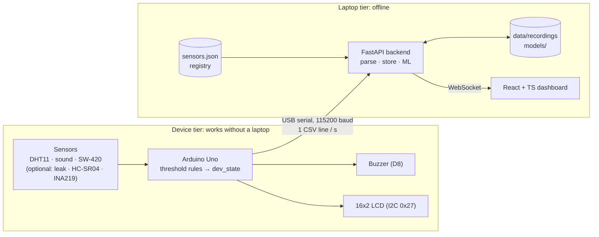

# Predictive Machine Health Monitor

An Arduino Uno watches a machine's temperature, humidity, sound and vibration (plus
optional water-leak, distance and current sensors) and sends one CSV line per second over
USB. On its own, the Arduino applies threshold rules and raises alarms with a buzzer and
a 16x2 LCD, so it keeps protecting the machine with no laptop attached. When a laptop is
connected, a Python FastAPI backend reads the serial stream, stores recordings, runs a
machine-learning model to spot developing faults before they cross the hard limits, and
streams everything over WebSocket to a React + TypeScript dashboard. The software side is
built to run fully offline from a single portable folder (no Python or Node needed).
Embedded Systems course project (BCSE305L).

## Run the portable app (no install)

For presenting on any Windows 10/11 laptop. **No Python, no Node, no internet needed.**

1. Get `MachineHealthMonitor-v0.6.0-win64.zip` from the
   [GitHub releases page](https://github.com/NITHIN777-DOTCOM/machine-health-monitor/releases)
   (or the `release\MachineHealthMonitor\` folder from someone who built it).
   Right-click the zip -> Properties -> tick **Unblock** -> OK, then extract it anywhere
   (Desktop, `D:\Machine Health Monitor\`, a pendrive; spaces in the path are fine).
2. (Optional) plug in the Arduino.
3. Double-click **`Start.bat`**. A console window opens and, after about 5-15 s, the dashboard
   opens in the browser at http://127.0.0.1:8000. The console says which data source it chose
   (`Arduino on COM5` or `Simulator (no Arduino found)`).
4. **Close the console window to stop.** Closing the browser tab does not stop it.

- **Demo backup:** `Start (simulator only).bat` never touches the COM port. Use it if the
  Arduino misbehaves. In the dashboard: Controls -> scenario (Recovery is the best demo), or
  Controls -> Recorded -> `demo_SIMULATED_drift_recovery.csv` (5 minutes of simulated data:
  normal, drift into CRITICAL, recovery).
- **First start on a new laptop:** Windows SmartScreen says "Windows protected your PC" because
  the exe is not signed: click **More info -> Run anyway**.
- The folder's `QUICK_START.txt` covers the rest: browser didn't open, port busy, Arduino not
  detected, Serial Monitor holding the port, logs.
- Recordings go to `data
ecordings\` **inside that folder**; `config\*.json` there can be edited
  (restart after). The ML model is **provisional** (trained on simulated data).

## Architecture



## Build it yourself

On a development laptop with Python 3.11 (`backend/venv`, see [`backend/README.md`](backend/README.md))
and Node.js 20+, from the repo root:

```
build.bat
```

It runs `npm ci` + the dashboard tests + `npm run build`, the backend tests, then PyInstaller
(pinned in `backend/requirements-build.txt`, installed into the venv) with
[`packaging/MachineHealthMonitor.spec`](packaging/MachineHealthMonitor.spec), and assembles
`release\MachineHealthMonitor\` (exe + `_internal\`, the two start scripts, `QUICK_START.txt`,
`config\`, `models\`, empty `data
ecordings\`, `data\demo\` with the simulated demo recording,
`firmware\`) plus `release\MachineHealthMonitor-v<version>-win64.zip`. About 4 minutes;
~165 MB folder, ~71 MB zip. `release/` is not in git.

**Why a onedir build (a folder) and not one single exe:** a PyInstaller *onefile* exe unpacks
its ~150 MB of Python, numpy and scikit-learn into `%TEMP%` on every start: much slower
(especially from a pendrive) and the self-extracting pattern is what antivirus heuristics
flag most often. The onedir folder starts directly (about 5 s warm). UPX compression is off
for the same antivirus reason.

How the exe finds its files (`backend/app/paths.py`): read-only resources (built dashboard,
default config, shipped model) come from the bundle (`_internal\`); everything writable
(config, recordings, retrained models, logs) lives **next to the exe**, and missing config or
model files are copied there on first start. In development the same code uses the repo.
`backend/app/launcher.py` is the entry point (port choice, single instance, browser, banner);
it also runs unfrozen: `venv\Scripts\python -m app.launcher` from `backend/`.

Note: `npm ci` recreates `dashboard/node_modules`, which deletes Playwright's project-local
Chromium; run `npm run screenshots:install` again before `npm run screenshots`.

## Folder map

| Path | Contents |
|------|----------|
| `firmware/machine_monitor/` | Main Arduino sketch (Phase 7). |
| `firmware/tests/` | Single-sensor test sketches. |
| `firmware/archive/` | Old sketches. |
| `firmware/README.md` | Pin map, libraries, upload steps, lessons learned. |
| `backend/app/` | FastAPI application (serial reader, storage, ML, WebSocket). |
| `backend/config/sensors.json` | **Sensor registry**: the one list of sensors every part of the system reads. |
| `backend/tests/` | Backend tests. |
| `backend/scripts/` | Helper scripts (recording, training, simulation). |
| `dashboard/` | React + TypeScript dashboard (run instructions: [`dashboard/README.md`](dashboard/README.md)). |
| `data/recordings/` | Recorded sensor data (CSV), committed to git. |
| `data/synthetic/` | Generated training data (not in git; recreate with `backend/scripts/generate_synthetic.py`). |
| `models/` | Trained ML model, committed to git. **Currently PROVISIONAL: trained on synthetic data only** (see [`models/README.md`](models/README.md)). |
| `docs/eval/` | Evaluation reports. Only reports on real recordings are results. |
| `docs/DATA_CONTRACT.md` | **Serial format and stored-data format.** Read this first. |
| `packaging/` | PyInstaller spec, release assembler, start scripts and `QUICK_START.txt` for the portable build. |
| `build.bat` | Builds the portable app into `release/`. |

## Key documents

- [`docs/DATA_CONTRACT.md`](docs/DATA_CONTRACT.md): exact serial line format, empty-field
  rule, stored columns, sensor registry and how to add or remove a sensor.
- [`firmware/README.md`](firmware/README.md): wiring and how to flash the Arduino.

## Deployment on real machinery

All limits and the ML model in this project are **tuned for a bench demo** (finger on
the DHT11, taps and claps near the sensors). Deploying on an actual machine requires
recording that machine's own normal-operation data, re-deriving the limits from it, and
retraining the model. **The demo limits and model must not be reused as-is.** Details:
[`docs/DATA_CONTRACT.md` section 8](docs/DATA_CONTRACT.md#8-deployment-on-real-machinery).

## Tested with

Checked on 2026-10-23 on Windows 11 Home (10.0.26200):

| Tool | Output |
|------|--------|
| `python --version` | `Python 3.11.9` |
| `node --version` | `v24.16.0` |
| `arduino-cli version` | `arduino-cli  Version: 1.5.1 Commit: 01f3d4f2b Date: 2026-06-05T10:22:12Z` |
| `arduino-cli board list` | `COM5  serial  Serial Port (USB)  Arduino UNO  arduino:avr:uno  arduino:avr` |

**Board:** a genuine Arduino Uno (ATmega16U2 USB-serial chip, not a CH340 clone), so
the CH340 driver is not needed. It appeared on **COM5** on the dev laptop. The COM number
may be different on other laptops; the backend will auto-detect the port, so nobody has
to edit a config file for it.
