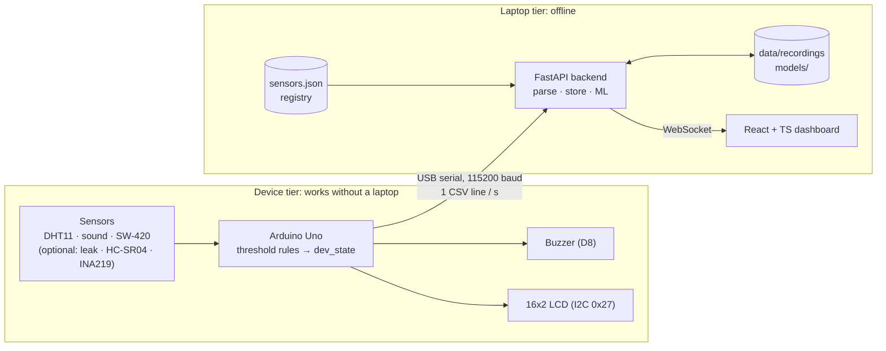

# Predictive Machine Health Monitor

An Arduino Uno watches a machine's temperature, humidity, sound and vibration (plus
optional water-leak, distance and current sensors) and sends one CSV line per second over
USB. On its own, the Arduino applies threshold rules and raises alarms with a buzzer and
a 16x2 LCD, so it keeps protecting the machine with no laptop attached. When a laptop is
connected, a Python FastAPI backend reads the serial stream, stores recordings, runs a
machine-learning model to spot developing faults before they cross the hard limits, and
streams everything over WebSocket to a React + TypeScript dashboard. The software side is
built to run fully offline from a single folder (`start.bat`, later a PyInstaller
`.exe`). Embedded Systems course project (BCSE305L).

## Architecture

## Folder map

| Path | Contents |
|------|----------|
| `firmware/machine_monitor/` | Main Arduino sketch. |
| `firmware/tests/` | Single-sensor test sketches. |
| `firmware/archive/` | Old sketches. |
| `firmware/README.md` | Pin map, libraries, upload steps, lessons learned. |
| `backend/app/` | FastAPI application (serial reader, storage, ML, WebSocket). |
| `backend/config/sensors.json` | **Sensor registry**: the one list of sensors every part of the system reads. |
| `backend/tests/` | Backend tests. |
| `backend/scripts/` | Helper scripts (recording, training, simulation). |
| `dashboard/` | React + TypeScript dashboard (run instructions: [`dashboard/README.md`](dashboard/README.md)). |
| `data/recordings/` | Recorded sensor data (CSV), committed to git. |
| `data/synthetic/` | Generated training data (not in git; recreate with `backend/scripts/generate_synthetic.py`). |
| `models/` | Trained ML model, committed to git. **Currently PROVISIONAL: trained on synthetic data only** (see [`models/README.md`](models/README.md)). |
| `docs/eval/` | Evaluation reports. Only reports on real recordings are results. |
| `docs/DATA_CONTRACT.md` | **Serial format and stored-data format.** Read this first. |

## Key documents

- [`docs/DATA_CONTRACT.md`](docs/DATA_CONTRACT.md): exact serial line format, empty-field
  rule, stored columns, sensor registry and how to add or remove a sensor.
- [`firmware/README.md`](firmware/README.md): wiring and how to flash the Arduino.

## Deployment on real machinery

All limits and the ML model in this project are **tuned for a bench demo** (finger on
the DHT11, taps and claps near the sensors). Deploying on an actual machine requires
recording that machine's own normal-operation data, re-deriving the limits from it, and
retraining the model. **The demo limits and model must not be reused as-is.** Details:
[`docs/DATA_CONTRACT.md` section 8](docs/DATA_CONTRACT.md#8-deployment-on-real-machinery).

## Tested with

Checked on 2026-10-23 on Windows 11 Home (10.0.26200):

| Tool | Output |
|------|--------|
| `python --version` | `Python 3.11.9` |
| `node --version` | `v24.16.0` |
| `arduino-cli version` | `arduino-cli  Version: 1.5.1 Commit: 01f3d4f2b Date: 2026-06-05T10:22:12Z` |
| `arduino-cli board list` | `COM5  serial  Serial Port (USB)  Arduino UNO  arduino:avr:uno  arduino:avr` |

**Board:** a genuine Arduino Uno (ATmega16U2 USB-serial chip, not a CH340 clone), so
the CH340 driver is not needed. It appeared on **COM5** on the dev laptop. The COM number
may be different on other laptops; the backend will auto-detect the port, so nobody has
to edit a config file for it.
