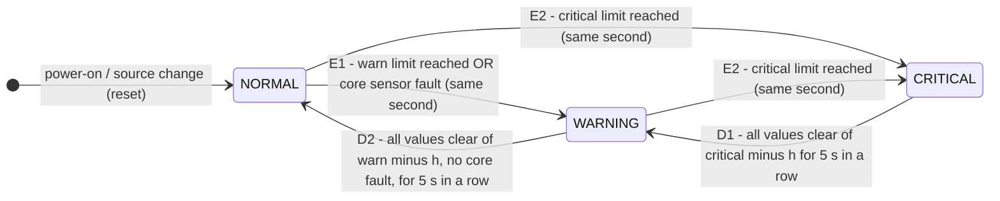

# Data Contract: Arduino → Backend serial format

This document is the single source of truth for what the Arduino sends over USB serial
and what the backend stores. Firmware, backend, ML and dashboard must all follow it.
If something here changes, change it here first.

## 1. Link settings

| Setting      | Value                                         |
|--------------|-----------------------------------------------|
| Transport    | USB serial (UART over the Uno's USB port)     |
| Baud rate    | **115200**, 8N1                               |
| Rate         | **one data line per second**                  |
| Line ending  | newline (`\n`); a trailing `\r` must be tolerated |
| Encoding     | ASCII                                         |
| Separator    | comma, no spaces, no quoting                  |

## 2. Line types

There are only two kinds of line:

1. **Comment / log lines** start with `#`. The backend **ignores** them for data (it may
   show them in a debug log). The firmware uses them for boot messages, sensor init
   results, errors, etc.
2. **Data lines**: everything else. Exactly 10 comma-separated fields (so exactly 9 commas).
   A data line with the wrong field count is dropped and logged by the backend.

### Header line

On boot (after `setup()` finishes) the Arduino prints exactly one header line. It is a
comment line whose content is the column list:

```
# ms,temp_c,humidity,sound_peak,vib_count,leak_raw,distance_cm,current_ma,bus_v,dev_state
```

The backend recognises it because the first name after `#` is `ms`. The backend can use it
to check that the firmware and backend agree on columns. Note that opening the COM port
resets the Uno, so the backend will normally see the header right after it connects.

## 3. Columns

The column order is **fixed**. Every column is always present, even when the sensor
behind it is disabled or not fitted; the field is then empty.

| # | Column        | Type    | Unit     | Sensor / source            | Meaning |
|---|---------------|---------|----------|----------------------------|---------|
| 1 | `ms`          | integer | ms       | `millis()`                 | Time since boot. Wraps after ~49.7 days. Never empty. |
| 2 | `temp_c`      | 1 dp    | °C       | DHT11 (A0)                 | Air temperature. |
| 3 | `humidity`    | 1 dp    | %RH      | DHT11 (A0)                 | Relative humidity. No rule limits (see below); used by ML. |
| 4 | `sound_peak`  | integer | counts   | Sound module (A2)          | Peak deviation from a running baseline during the last second. Quiet room ≈ 3–5; claps 60–590. |
| 5 | `vib_count`   | integer | edges/s  | SW-420 / HW-072 (D2, interrupt) | Interrupt edges counted in the last second. Still = 0; taps 5–40; knocks 100+. |
| 6 | `leak_raw`    | integer | 0–1023   | Water leak sensor (A1)     | Raw ADC value; higher = wetter. Dry 4–9, wet 240–576. *Optional.* |
| 7 | `distance_cm` | 1 dp    | cm       | HC-SR04 (D9 Trig / D10 Echo) | **Safety zone**: distance to the nearest person/object. **`400` = no echo, nothing in range (clear)**; empty = sensor fault. *Optional.* |
| 8 | `current_ma`  | 1 dp    | mA       | INA219 (I2C 0x40)          | Load current. *Optional.* |
| 9 | `bus_v`       | 2 dp    | V        | INA219 (I2C 0x40)          | Bus voltage. *Optional.* |
| 10 | `dev_state`  | enum    | –        | computed on the Arduino    | `NORMAL`, `WARNING` or `CRITICAL`. Never empty. |

"dp" = decimal places. Decimal separator is always `.`.

### The empty-field rule

> A sensor that is **missing, disabled or failed** sends an **empty field**: never `0`,
> `-1`, `NaN` or any other placeholder.

`0` is a real reading (for example, no vibration), so it must never mean "no data". The
backend turns empty fields into "no value" (`None`/`null`), never into 0.

**One special value that is a real reading, not a placeholder: `distance_cm = 400`.** The
HC-SR04 gives no echo when nothing is within its range (about 4 m), which is the *good*
case for a safety zone. The firmware then reports `400` (the sensor's maximum range), so it
counts as clear; the dashboard shows it as "> 400 cm (clear)" (`out_of_range_value` in the
registry). An empty `distance_cm` still means a genuine fault (sensor not answering).

The backend tells the two cases apart using the sensor registry (section 6):

- sensor `enabled: false` and field empty → shown as **"not connected"**
- sensor `enabled: true` and field empty → shown as **"no reading / sensor fault"**

### `dev_state` (device-side rules)

The Arduino computes `dev_state` itself so that the buzzer and LCD work with no laptop.
It is a small **state machine** with three states, `NORMAL` < `WARNING` < `CRITICAL`,
updated once per data line (once per second). It **goes up fast and comes down slowly**,
so a value hovering around a limit cannot make the buzzer and LCD flicker.

Two things can raise the state:

1. **Limits:** a sensor value reaches its `warn` or `critical` limit (table below).
2. **The sensor-fault rule:** an **enabled core** sensor sends an empty field (read
   failed, timeout, checksum error). The state becomes **at least `WARNING`, never
   `NORMAL`**, and the LCD shows the reason, e.g. `SENSOR FAULT: DHT`. If another sensor
   is over its critical limit at the same time, the state is `CRITICAL`.

Each limit has a direction (`direction` in the registry, section 7): `above` means a
value at or above the limit is bad; `below` means a value at or below the limit is bad.
Every limit is `above` except the safety zone `distance_cm`, which is `below` (a person or
object **closer** than the limit is bad).

#### State diagram



There is **no direct `CRITICAL → NORMAL` transition**: coming down always passes
through `WARNING`, and each step down needs its own full hold time.

#### Transition conditions

`h` = the sensor's `hysteresis` margin (registry); `hold` = `hold_seconds` (backend
`settings.json`, currently **5**). "Reaches" depends on direction: for `above` it means
value ≥ limit; for `below`, value ≤ limit.

| Transition | Type | Condition (checked every row) | Timing |
|---|---|---|---|
| **E1** `NORMAL → WARNING` | escalation | any enabled sensor reaches its `warn` limit, **or** any enabled core sensor is empty | immediate, same row |
| **E2** `NORMAL/WARNING → CRITICAL` | escalation | any enabled sensor reaches its `critical` limit | immediate, same row (can skip `WARNING`) |
| **D1** `CRITICAL → WARNING` | de-escalation | **every** enabled sensor is clear of its critical limit by `h`: value < `critical − h` (`above`) or value > `critical + h` (`below`) | condition true for `hold` **consecutive** rows |
| **D2** `WARNING → NORMAL` | de-escalation | **every** enabled sensor is clear of its warn limit by `h` (same rule with `warn`) **and** no enabled core sensor is empty | condition true for `hold` **consecutive** rows |

- **Hold counter:** it counts consecutive rows where the de-escalation condition is
  true. Any row where it is false (the value is back inside the margin band) resets the
  counter to 0. An escalation also resets it.
- **Margin band:** a value between `limit − h` and the limit (e.g. 34.5–35 °C for
  `temp_c` critical) does not raise the state, but it keeps the current state from
  clearing.
- **Reason:** the device remembers which sensor and limit caused the state, e.g.
  `Temperature 35.1 >= crit 35` or `SENSOR FAULT: DHT11`, and the LCD shows it. While
  counting down, the last reason is kept but marked as history
  (`recovering, was: Temperature 35.1 >= crit 35`), and the remaining hold time is shown.

Hysteresis margins (`hysteresis` in the registry):

| Sensor | `h` | Example |
|---|---|---|
| `temp_c` | 0.5 °C | CRITICAL at 35.0 → must fall below 34.5 for 5 s to drop to WARNING |
| `sound_peak` | 10 | CRITICAL at 120 → must stay below 110 for 5 s |
| `vib_count` | 10 /s | WARNING at 50 → must stay below 40 for 5 s |
| `leak_raw` | 20 | CRITICAL at 200 → must stay below 180 for 5 s |
| `distance_cm` | 3 cm | `below`: WARNING at 20 → must stay **above** 23 for 5 s |
| INA219 (`current_ma`, `bus_v`) | `null` (= 0) | limits TBD (not fitted) |

#### Worked example (`temp_c`, warn 32, critical 35, h 0.5, hold 5)

| Row | temp_c | State | Why |
|---|---|---|---|
| 1 | 32.1 | `WARNING` | E1: reached warn 32, same row |
| 2 | 31.8 | `WARNING` | below 32 but inside the band (≥ 31.5): hold counter stays 0 |
| 3–6 | 31.4 | `WARNING` | clear of 31.5: hold 1, 2, 3, 4 |
| 7 | 31.4 | `NORMAL` | D2: clear for 5 consecutive rows |
| 8 | 35.0 | `CRITICAL` | E2: straight from NORMAL to CRITICAL |
| 9–13 | 34.4 | `CRITICAL` → `WARNING` at row 13 | D1: clear of 34.5 for 5 rows; one level only |
| 14–18 | 31.0 | `WARNING` → `NORMAL` at row 18 | D2: a separate 5-row hold |
| 19 | empty | `WARNING` | E1: core sensor fault |

#### Worked example 2 (`distance_cm`, direction below, warn 20, critical 10, h 3, hold 5)

The same rules mirrored for a `below` limit: "reaches" means value ≤ limit, and "clear by
`h`" means value > limit + h.

| Row | distance_cm | State | Why |
|---|---|---|---|
| 1 | 150.0 | `NORMAL` | nothing near the machine |
| 2 | 20.0 | `WARNING` | E1: reached warn 20 (≤ 20), same row |
| 3 | 22.0 | `WARNING` | above 20 but inside the band (≤ 23): hold counter stays 0 |
| 4–7 | 25.0 | `WARNING` | clear of 23: hold 1, 2, 3, 4 |
| 8 | 25.0 | `NORMAL` | D2: clear for 5 consecutive rows |
| 9 | 8.0 | `CRITICAL` | E2: straight from NORMAL to CRITICAL |
| 10–14 | 14.0 | `CRITICAL` → `WARNING` at row 14 | D1: clear of 13 for 5 rows; one level only |
| 15–19 | 400.0 | `WARNING` → `NORMAL` at row 19 | `400` = nothing in range, clear |
| 20 | empty | `NORMAL` | optional sensor: an empty field does not raise the state (dashboard shows a fault) |

Both tables are executable: `backend/tests/test_device_rules.py` runs them through
`device_rules.py`, `backend/scripts/gen_firmware_config.py` compiles them into the firmware's
parity test, and `backend/scripts/firmware_parity.py` checks that the Arduino gives the same
state on every row.

The backend runs the same state machine (`backend/app/device_rules.py`,
`DeviceStateMachine`) for the simulator and as a mirror of the real device. The firmware
has a C++ port (`firmware/machine_monitor/state_machine.h`) that is checked row by row
against it (parity test, see `firmware/README.md`). `GET /api/status` and every WebSocket row include its
`state`, `reason`, `hold_remaining_s` and whether it `agrees` with the device's own
`dev_state`.

| Sensor       | WARNING at | CRITICAL at |
|--------------|-----------|-------------|
| `temp_c`     | ≥ 32 °C   | ≥ 35 °C     |
| `humidity`   | none      | none        |
| `sound_peak` | ≥ 40      | ≥ 120       |
| `vib_count`  | ≥ 50 /s   | ≥ 100 /s    |
| `leak_raw`   | ≥ 50      | ≥ 200       |
| `distance_cm`| **≤** 20 cm | **≤** 10 cm |
| `current_ma` | TBD       | TBD         |
| `bus_v`      | TBD       | TBD         |

**Humidity has no rule limits** (Phase 7.2): it is not a machine-fault signal, room humidity in
Chennai sits around 80 %RH (the bench sat in WARNING all day with the old 80 % limit) and the
DHT11 only measures up to 90 %RH. It stays enabled, on the dashboard and in ML; a DHT11 read
failure still raises WARNING through the sensor-fault rule (temp_c and humidity share the module).

**All other limits are provisional demo limits** (each has a `limits_note` in the registry). They are low on purpose so a live bench demo can trigger them: a finger on the
DHT11 gives about 32–33 °C (WARNING), firm knocks pass 50 vibration edges/s (light taps stay below; very hard knocks pass 100, bench-calibrated in Phase 7.2), and a clap
passes a sound peak of 40, a wet finger on the leak sensor gives 240+, and a hand within
10 cm of the ultrasonic sensor is CRITICAL. They will be retuned from real recordings in
Phase 8. The numbers live only in `backend/config/sensors.json` (`warn` / `critical` /
`hysteresis` / `direction`) and `settings.json` (`hold_seconds`); the firmware gets them from
the generated `firmware/machine_monitor/config_generated.h` (run
`backend/scripts/gen_firmware_config.py` after a change; a backend test fails while the
header is out of date). See section 8 before using any of these limits on a real machine.

## 4. Example lines

Header plus three data lines:

```
# ms,temp_c,humidity,sound_peak,vib_count,leak_raw,distance_cm,current_ma,bus_v,dev_state
12000,29.0,62.0,4,0,18,41.3,182.4,4.98,NORMAL
13000,33.0,61.0,12,3,,,,,WARNING
14000,,,5,0,,,,,WARNING
```

1. **All sensors present** (`12000`): every field filled, everything inside limits.
2. **Core sensors only** (`13000`): leak, ultrasonic and INA219 are not fitted, so their
   four fields are empty. Temperature 33 °C is at or above the 32 °C warning limit but
   below the 35 °C critical limit; sound and vibration are below their limits → `WARNING`.
3. **Failed core sensor** (`14000`): the DHT11 read failed (timeout/checksum), so
   `temp_c` and `humidity` are empty, not 0. Sound and vibration are normal, but because
   an enabled core sensor failed, the sensor-fault rule raises `dev_state` to `WARNING`
   and the LCD shows `SENSOR FAULT: DHT`. The backend also flags it as a sensor fault,
   because the DHT11 is enabled in the registry.

## 5. What the backend stores

When the backend saves a row (to `data/recordings/*.csv`), it keeps all 10 device columns
unchanged and adds these columns:

| Column   | Values                              | Meaning |
|----------|-------------------------------------|---------|
| `ts_iso` | ISO 8601 with timezone, e.g. `2026-10-23T18:40:05+05:30` | Laptop wall-clock time when the line was received. |
| `mode`   | `live` / `recorded` / `simulated`   | `live` = from the Arduino right now; `recorded` = replayed from a file; `simulated` = generated by the backend's simulator. |
| `source` | `real` / `synthetic`                | Whether the numbers came from real sensors or were generated. A replayed real recording stays `real`. |
| `label`  | `normal` / `fault` / `unknown`      | Ground truth for ML training. Default `unknown`; set when recording a known condition. |

Stored column order:

```
ts_iso,ms,temp_c,humidity,sound_peak,vib_count,leak_raw,distance_cm,current_ma,bus_v,dev_state,mode,source,label
```

Empty device fields stay empty in the stored file.

## 6. ML scope

> **Rule:** a sensor is **used by ML** only if `enabled` **and** `include_in_ml` are both
> `true`. A sensor is **shown on the dashboard** if `enabled` is `true`. (A sensor with
> `enabled: false` is still listed on the dashboard, but as "not connected" with no value.)

- A disabled optional sensor is simply left out of the ML features.
- **Current (`current_ma`) and bus voltage (`bus_v`) are shown on the dashboard but are
  excluded from ML.** Without a real motor load the INA219 only measures a constant
  bench current, which carries no information about machine health. If a real motor
  load is added later, set `include_in_ml: true` for both and retrain.
- `ms` and `dev_state` are never ML features. `dev_state` is the device's rule-based
  verdict and can be compared against the ML result.

## 7. Sensor registry: `backend/config/sensors.json`

The registry describes every sensor. **The backend, ML pipeline and dashboard must read
the sensor list from this file and never hard-code it.**

Top-level fields:

| Field            | Meaning |
|------------------|---------|
| `schema_version` | Registry format version (currently 2: version 2 added `direction`, `group` and `comment`). |
| `csv_columns`    | The exact column order of a data line (same as section 3). |
| `sensors`        | One entry per sensor column (everything except `ms` and `dev_state`). |

Fields of each sensor entry:

| Field           | Type            | Meaning |
|-----------------|-----------------|---------|
| `key`           | string          | Must equal the CSV column name. |
| `display_name`  | string          | Label shown on the dashboard. |
| `unit`          | string          | Unit shown on the dashboard. |
| `hardware`      | string          | Physical module (for docs and the dashboard tooltip). |
| `pin`           | string          | Arduino pin(s), for reference. |
| `warn`          | number or null  | Warning limit; `null` = TBD / no limit. |
| `critical`      | number or null  | Critical limit; `null` = TBD / no limit. |
| `direction`     | `above` / `below` | `above`: a value **at or above** the limit is bad. `below`: a value **at or below** the limit is bad. |
| `tier`          | `core` / `optional` | Core sensors must work in the final build; optional ones may be left out. |
| `enabled`       | boolean         | Whether this sensor is fitted in the current build. `false` → dashboard shows "not connected". |
| `include_in_ml` | boolean         | Whether this sensor is used as an ML feature (only when also enabled; see section 6). |
| `forecast`      | boolean         | Whether the backend shows a time-to-limit trend forecast for this sensor. `true` for slow signals with limits (temperature); `false` for humidity (no limits to forecast) and for spiky event signals (sound, vibration), where a straight-line trend misleads. |
| `group`         | string, optional | Sensors that come from one physical module. All entries in a group must be enabled or disabled **together**. Currently only `ina219` (`current_ma` + `bus_v`). |
| `hysteresis`    | number or null  | De-escalation margin `h` (section 3): to leave a level, the value must be clear of the limit by `h`, in the limit's direction. `null` = no margin. |
| `limits_note`   | string, optional | Where the limits come from, e.g. "provisional demo limit - retune from real data in Phase 8". The dashboard can show it next to the limits. |
| `out_of_range_value` | number, optional | A reading at or past this value means "nothing in range" (a real, clear reading). Only `distance_cm`: `400`. The dashboard shows it as "> 400 cm (clear)". |
| `firmware_flag` | string          | Firmware only: the `USE_<SENSOR>` define generated for this sensor's module, e.g. `USE_HCSR04`. Sensors on one module share a flag (`USE_DHT11`, `USE_INA219`). |
| `lcd_name`      | string (≤ 4)    | Firmware only: short name on the 16x2 LCD, e.g. `VIB` in `CRIT VIB 66>60`. |
| `comment`       | string, optional | Free-text note for humans; ignored by the software. |

Current state: the four core values, the water leak sensor and the ultrasonic safety zone
are enabled; the INA219 (`current_ma`, `bus_v`) is `enabled: false` (not fitted). Only the
four core values are ML features: leak and distance are `include_in_ml: false` because a
leak or a person in the safety zone is a rule-based event (adding them would also need a
retrain), and the INA219 is excluded (section 6). Every entry uses `direction: "above"`
except `distance_cm` (`below`).

**Groups:** enabling or disabling a group means toggling `enabled` on **every** entry with
that `group` value. For the INA219 that's both `current_ma` and `bus_v`; the firmware
flag `USE_INA219` switches both columns at once. The backend should treat a group whose
members disagree as a configuration error.

### How to add or remove an optional sensor (no code changes)

1. **Registry:** in `backend/config/sensors.json`, set `"enabled"` to `true` or `false`
   for that sensor's entry. If the entry has a `group` (e.g. `ina219`), change every
   entry in that group (`current_ma` **and** `bus_v`).
   Set `include_in_ml` if it should or shouldn't be an ML feature.
2. **Firmware:** run `backend\venv\Scripts\python backend\scripts\gen_firmware_config.py`
   (from the repo root). It rewrites `firmware/machine_monitor/config_generated.h`, which
   sets the module's `USE_<SENSOR>` flag to `1` (fitted) or `0` (removed). Compile and
   upload. When a flag is `0` the firmware still prints the column, just empty.
3. **Restart and retrain:** restart the backend (`start.bat`) so it rereads the registry,
   and retrain the ML model if the set of ML features changed. The dashboard picks up
   the change on its own.

Adding a **brand-new kind** of sensor (a column that does not exist yet) is a contract
change: add the column to section 3 and to `csv_columns`, add a registry entry, and
update the firmware to print it. New columns go at the end of the line so old
recordings stay readable.

## 8. Deployment on real machinery

All limits and the ML model in this project are **tuned for a bench demo**: a DHT11
warmed by a finger, taps and claps near the sensors, and a quiet desk. They say nothing
about what is normal for any real machine.

Deploying the monitor on an actual machine requires:

1. **Recording that machine's own normal operation** (`mode=live`, `label=normal`) over
   enough time to cover its usual load, speed and temperature changes.
2. **Re-deriving the limits** (`warn` / `critical` in `sensors.json`, then regenerating
   the firmware header and re-uploading) from that recording.
3. **Retraining the ML model** on that machine's data.

**The demo limits and the demo model must not be reused as-is on real equipment.**

## 9. Live analysis (backend)

For every row the backend adds an `analysis` block (WebSocket rows, `/api/status`,
`/api/history`). It is **never** written to recordings: those stay raw contract rows,
so they remain clean training data and the analysis can always be recomputed.

**Three opinions, one overall status.**

| Part | What it says | Can make the overall status |
|---|---|---|
| Device rules (`dev_state`) | Limits and sensor faults, section 3 | NORMAL, WARNING, CRITICAL |
| ML (`ml.status`) | The pattern of the last 10 s differs from normal | at most **WARNING** |
| Forecast | Time until a limit is reached, for `forecast: true` sensors | nothing (shown as advice) |

- `overall` = the worse of the rules state and the ML verdict. **ML is advisory**: an ML
  ANOMALY can raise the overall status to WARNING, never to CRITICAL. Only the threshold
  rules can make it CRITICAL.
- `alert_source` = `rules`, `ml`, `both` or `none`.
- `headline` is one short human sentence and `headline_detail` a smaller second line with
  the exact values (or `null`):

  | Situation | `headline` | `headline_detail` |
  |---|---|---|
  | Rule limits | "Sound level and vibration above critical limits" | "Sound level 143, crit limit 120 · Vibration 140, crit limit 100 · ML anomaly (health 0)" |
  | Core sensor empty | "Sensor fault: DHT11" | "DHT11: no reading" |
  | ML only | "Unusual vibration pattern (health 34)" | "Vibration: far above normal" |
  | ML clearing | "Back to normal; ML anomaly clearing in 4 s" | "Health 90" |
  | Forecast | "Temperature may reach critical in ~3 min" | "Temperature rising: warning in ~1 min, critical in ~3 min" |
  | Normal | "All systems normal" | "Health 98", or "ML warming up: 9 s left" |

  Names drop their explanation in brackets ("Sound level (peak deviation)" → "Sound level").

**Health score** (0–100, `ml.health`; `backend/app/ml/scorer.py`):

- IF part: r = (score − threshold) / (median − threshold). For r ≥ 0 it is 50 + 50·r
  (100 at the median normal window, 50 at the model's decision threshold). Below the
  threshold it decays softly as 50 / (1 − r): 25 one "normal spread" below, 12.5 at three.
  IsolationForest scores saturate outside the training data, so this part alone never says 0.
- Range part: excess = the largest distance of any window feature beyond its training
  min/max, in training standard deviations. Range part = 100 − 16.7·ln(1 + excess / 0.28),
  clamped 0..100 (`k`, `b` in `model_meta.json` → `range_excess`).
- health = min(IF part, range part). Moderately out-of-range values give a mid score and only
  extreme values reach 0:

  | Window (other sensors normal) | excess | health (Phase 3 formula) | health (Phase 5) |
  |---|---|---|---|
  | temperature 31.5 °C | 1.4 | 71.5 | 70 |
  | temperature 32.5 °C | 2.6 | 51 | 61 |
  | humidity 85 % | 3.4 | 31 | 57 |
  | vibration 8 /s | 6.4 | 0 | 44 |
  | vibration 13 /s (normal 0–6) | 13.8 | 0 | 35 |
  | vibration 20 /s | 24 | 0 | 25 |
  | sound 45 | 46 | 0 | 15 |
  | vibration 64 /s | 89 | 0 | 4 |
  | vibration 120 /s | 171 | 0 | 0 |

**Causes** (`ml.causes`, top 2): each has the window `feature`, its `z` (standard deviations
from the normal mean, capped at ±99), a `band` and plain-language `text`, e.g.
"Vibration: far above normal". Bands of |z|: **< 2 normal, 2–3 slight, 3–6 clear, ≥ 6 far**.
Words by statistic: level features (mean/last/min/max) "slightly high / above normal / far
above normal" (or low/below); std "slightly unstable / unstable / very unstable" (or
"unusually steady"); slope "rising slightly / rising / rising fast" (or falling). Per sensor
the feature with the largest |z| is used, **except that an unusual level feature (|z| ≥ 2) wins
over a larger std or slope z**, so a vibration fault reads "far above normal", not "very
unstable", in the list and in `headline_detail`. The dashboard lists causes only while ML is
ANOMALY or health is at or below the clear level (60); otherwise it says "Nothing unusual". The
dashboard shows the words and puts z only in a tooltip (never a capped value like 99).

**ML status** is one of `OK`, `ANOMALY`, `WARMING_UP` (window not full yet; seconds left
are shown), `ML_UNAVAILABLE` (an ML sensor is missing in more than 30% of the window,
e.g. a DHT11 fault), `NO_MODEL`, `NEEDS_RETRAIN` (the registry's ML sensors differ from
the model's; ML is off and the rules keep working). It is smoothed so it cannot flicker:
it becomes ANOMALY only after health < 50 for 3 consecutive rows and clears only after
health > 60 for 5 consecutive rows. These levels come from `settings.json` and are sent as
`ml_thresholds` (`anomaly_health`, `anomaly_rows`, `clear_health`, `clear_rows`) in
`GET /api/status` and `GET /api/model`, so the dashboard never hard-codes them.

**Forecast** per `forecast: true` sensor: `status` is `approaching`, `reached`, `stable`,
`insufficient_data`, or **`no_data` as soon as the newest row has no value** for that sensor
(e.g. the DHT11 failed): it never reports "stable" from old readings. `r2` is the line fit;
the dashboard shows it as **confidence: low (R² < 0.6, the backend does not trust a trend
below `forecast_min_r2`), medium (0.6–0.85), high (≥ 0.85)**, with R² in a tooltip.

`GET /api/status` also has `serial`: `{available, port, note}`. `available` is false with
`MHM_SOURCE=simulator` (ports are never listed) or when no Arduino is found (checked at most
every 5 s), and `note` says why. For a replay, `progress` is the share of the file played in
the current pass (0..1; `source_detail` has `rows_total` and `passes`). While recording or
replaying, the backend pushes a status message once a second so the row count, elapsed time
and progress stay current. `GET /api/recordings` lists `file`, `folder` (`recordings` or
`demo`), `rows`, `duration_s` (device clock, i.e. what a 1x replay takes), `size_bytes` and
`modified` (ISO time); `data/demo/` holds the simulated demo recording of the portable build.
`GET /api/status` also has `version`: `{app, name, version, git, build_date, frozen}`.

**Link fields** in `GET /api/status`: `link` (`starting`, `ok`, `no_data`, `down`, `finished`),
`silent_s` (seconds without a good row, counted from the source start if none came yet),
`rejecting` (lines **are** arriving but every one is rejected, e.g. the wrong sketch or baud
rate: lines rejected since the last good row, the newest within 15 s), `rejected_recent`
(that count), and `last_reject_reason` / `last_rejected_line`. The dashboard uses them to
say either "The data source is silent (no rows for 12 s). Check the USB cable and the
Arduino." or "The Arduino is sending data, but not in the expected format (3 lines rejected).
Is the correct sketch uploaded?". Opening the serial port resets the Uno: the backend flushes
output buffered from before the reset 1 s after opening, and drops a row the reset cut off
(text before a `#` on the same line) without counting it as rejected.

**Warm start.** A recording's last W + 60 s can pre-fill the ML window and the forecast
history, so a new source doesn't start with "warming up". For the first W live rows the
ML window mixes recorded and live data, so ML shows "settling" without a health value and
cannot raise an alarm; the forecast works from the first row.
